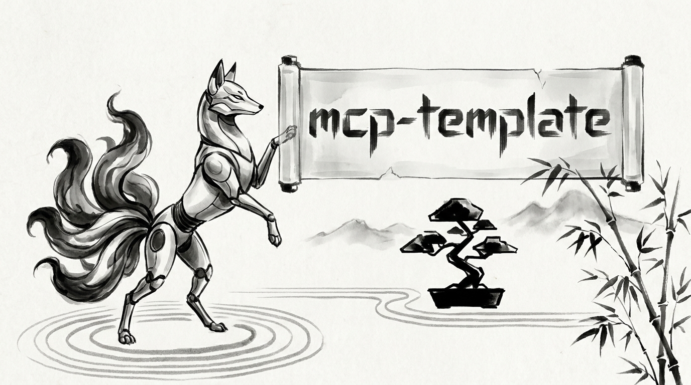
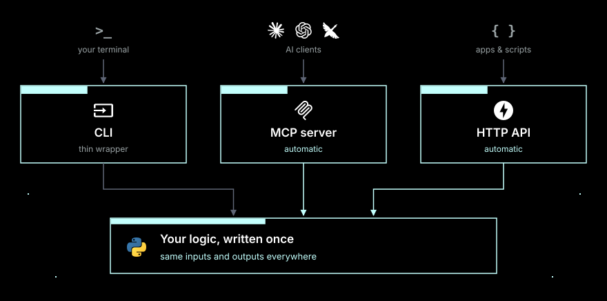
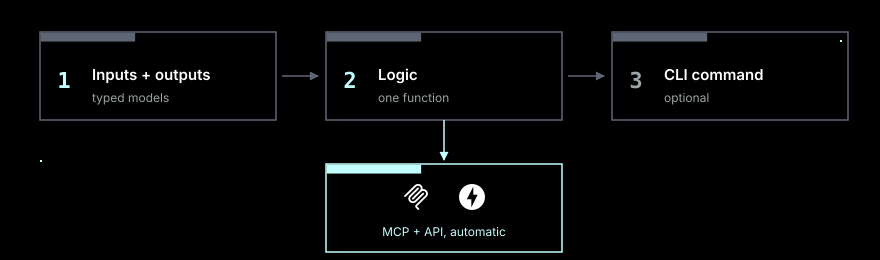

# mcp-template

<p align="center">
  
</p>

<p align="center">
<b>Batteries-included Python template. One codebase ships as a CLI, an MCP server, and an HTTP API over a shared service registry.</b>
</p>

<p align="center">
  <a href="#how-it-works">How it works</a> •
  <a href="#quick-start">Quick Start</a> •
  <a href="#add-a-feature">Add a feature</a> •
  <a href="#mcp-apps">MCP Apps</a> •
  <a href="#stack">Stack</a> •
  <a href="manual_docs/deploy.md">Deploy</a>
</p>

<p align="center">
  <a href="https://railway.com/deploy/gmailmcp"></a>
  &nbsp;
  <a href="https://render.com/deploy?repo=https://github.com/Miyamura80/MCP-Template"></a>
</p>

<p align="center">
  
  
  
  
  <a href="https://skills.sh/Miyamura80/MCP-Template"></a>

</p>

---

## How it works

<p align="center">
  
</p>

Write business logic once as a `@service` in `services/`. It is registered automatically as an MCP tool (streamable HTTP at `/mcp`) and an authenticated `POST /api/v1/services/<name>` route, both sharing one Pydantic contract. The CLI is a thin Typer command over the same function. Ship it as an OAuth MCP server, a Claude connector or ChatGPT app, an API, or a dashboard on the same layer.

## Quick Start

```bash
make onboard              # interactive setup: rename, deps, env, hooks
uv run mymcp --help       # CLI (shell completions + `mymcp update` built in)
uv run mymcp-serve        # HTTP API + MCP at /mcp, one port
uv run mymcp-mcp          # legacy stdio MCP for local Claude Desktop
```

Deploy in one click to [Railway](https://railway.com/deploy/gmailmcp) or [Render](https://render.com/deploy?repo=https://github.com/Miyamura80/MCP-Template) (backend + Postgres, migrations run automatically): [deploy docs](manual_docs/deploy.md).

**Agent install** (paste into Claude Code, Cursor, Copilot...):

```text
pip install mcp-template
npx skills add Miyamura80/MCP-Template   # gmail-mcp skill, published on skills.sh
```

The skill's source is [`skills/gmail-mcp/SKILL.md`](skills/gmail-mcp/SKILL.md); `make sync-skills` mirrors it to the landing page's `/.well-known/agent-skills/`.

## Add a feature

<p align="center">
  
</p>

```python
# models/word_count.py
class CountInput(BaseModel):
    text: str


class CountResult(BaseModel):
    words: int


# services/word_count_svc.py
@service(
    name="word_count",
    description="Count the words in a text",
    input_model=CountInput,
    output_model=CountResult,
)
def word_count(input: CountInput) -> CountResult:
    return CountResult(words=len(input.text.split()))
```

That is the whole MCP tool and HTTP route. Pass `mutating=True` for side effects (REST then requires an `Idempotency-Key`), or `price="0.01"` to charge per call over x402. Test it with a `TestTemplate` subclass.

<details>
<summary><b>CLI command</b> (optional): drop a file in <code>src/cli/commands/</code></summary>

A file exporting `main()` becomes a single command; one exporting `app = typer.Typer()` becomes a group. Both are auto-discovered; `uv run mymcp init my_command` scaffolds one.

```python
# src/cli/commands/word_count.py
def main(text: Annotated[str, typer.Argument()]) -> None:
    """Count the words in a text."""
    render(word_count(CountInput(text=text)))
```

</details>

## MCP Apps

<p align="center">
  
</p>

An opt-in **enhancer** (`mcp_server/enhancers/`) gives one tool MCP-only extras: elicitation, image output, or an interactive [MCP App](https://github.com/modelcontextprotocol/ext-apps) rendered in the chat. The service, CLI and API stay unchanged. Design: [`MCP_UI_ARCHITECTURE.md`](mcp_server/MCP_UI_ARCHITECTURE.md).

## Stack

| Area | Stack |
|---|---|
| Interfaces | Typer CLI · MCP Python SDK 2.x · FastAPI |
| Auth & billing | WorkOS + API keys · Stripe subscriptions · x402 pay-per-call |
| Data & config | SQLAlchemy + Alembic · pydantic-settings (YAML + `.env`) |
| LLM | DSPY + LiteLLM + LangFuse |
| Quality | pytest · Ruff · ty · Vulture · import-linter · prek hooks |

CLI global flags go before the subcommand: `-v`, `-q`, `--debug`, `-f table|json|plain`, `--dry-run`, `-V`. Config: `global_config.<key>` in code, `uv run mymcp config show|get|set` from the shell ([docs](manual_docs/configuration.md)). Telemetry is anonymous and opt-out.

Built with [uv](https://docs.astral.sh/uv/), [Typer](https://typer.tiangolo.com/), [Rich](https://rich.readthedocs.io/), [prek](https://github.com/j178/prek), [DSPY](https://dspy.ai/), [LangFuse](https://langfuse.com/) and [Cursor](https://cursor.com). Diagrams: `make gen_readme_diagrams` ([source](scripts/gen_readme_diagrams.py)).

## About the Core Contributors

<a href="https://github.com/Miyamura80/MCP-Template/graphs/contributors">
  
</a>

Made with [contrib.rocks](https://contrib.rocks).
